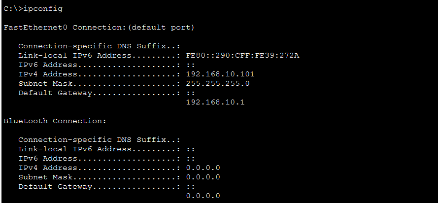

# Cybrarians November Challenge: Office Network (VLANs)

**Name:** Hanifah Owolabi Yusuf  
**Department/Level:** Computer Science / 300 Level  
**Date submitted:** 25 November 2026

## What I Built

I designed and configured an office network using Cisco Packet Tracer, consisting of **12 PCs across two VLANs**, two switches, one router, and one server.

- **VLAN 10 (Staff):** 6 PCs and 1 Staff Server
- **VLAN 20 (Guests):** 6 PCs
- **Switches:** 2 Cisco 2960 switches
- **Router:** 1 Cisco 2911 router

The network uses trunk links between the switches and router-on-a-stick for inter-VLAN routing. DHCP automatically assigns IP addresses to devices in both VLANs, while an extended ACL restricts Guest access to the Staff network and server.

## Tasks Completed

- [x] VLANs created and ports assigned
- [x] Trunk between switches
- [x] Router-on-a-stick (inter-VLAN routing)
- [x] DHCP for both VLANs
- [x] ACL blocking Guests from accessing Staff and the server
- [x] Bonus: Port Security configured using sticky MAC learning
- [x] Bonus: Switch login passwords configured on both switches

## IP Plan

| VLAN | Network | Gateway |
|---|---|---|
| VLAN 10 – Staff | 192.168.10.0/24 | 192.168.10.1 |
| VLAN 20 – Guests | 192.168.20.0/24 | 192.168.20.1 |

**Staff Server (Static IP):** `192.168.10.100`

## Proof

### Staff pinging the server (Success)

Staff-PC1 successfully communicated with the Staff Server with 0% packet loss.

### Guest pinging the server (Blocked)

Guest-PC1 was unable to reach the Staff Server, confirming that the ACL restriction works.

### DHCP working – Staff VLAN

## Challenges I Faced

Configuring router-on-a-stick and troubleshooting ACL rules were challenging. I resolved them by reviewing configurations, adjusting the ACL, and testing connectivity until everything worked as expected.

## Files

- `Hanifah_Owolabi_Yusuf_VLAN_Challenge.pkt` – Cisco Packet Tracer project file.
- `staff_ping_success.png` – Staff-to-server connectivity proof.
- `guest_ping_fail.png` – Guest access restriction proof.
- `dhcp_proof.png` – Staff DHCP proof.

---

**Built with Cisco Packet Tracer | Cybrarians November Challenge 2026**
